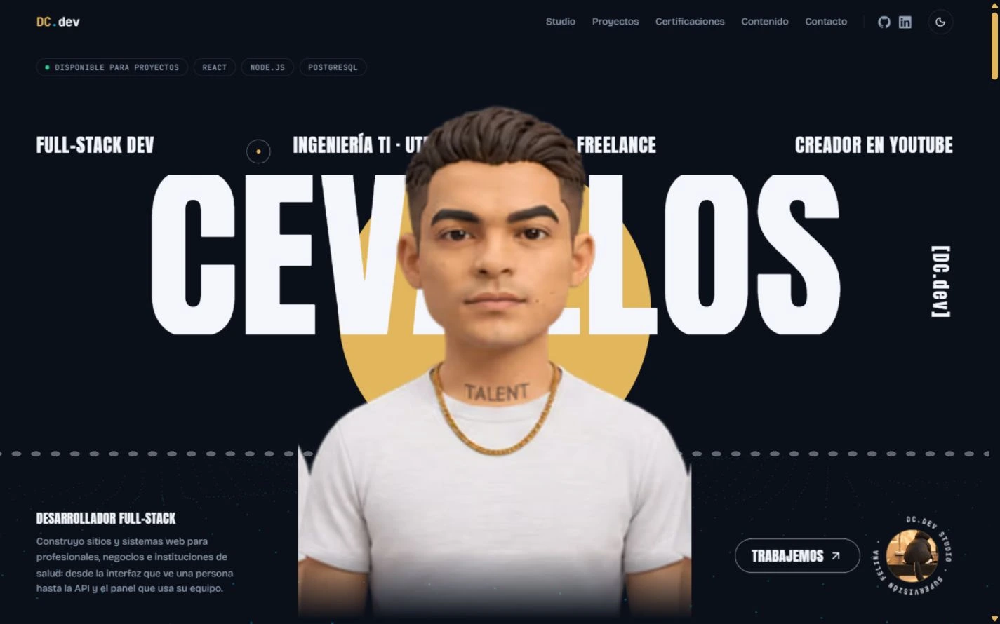
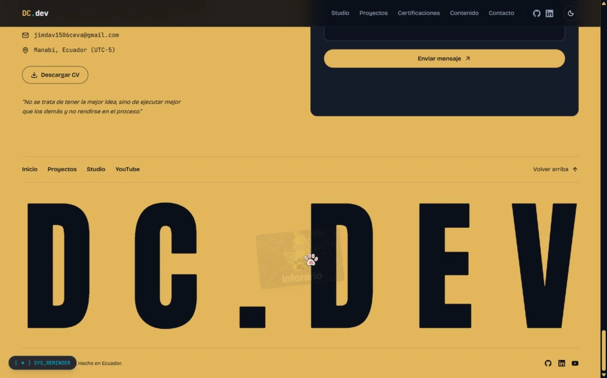
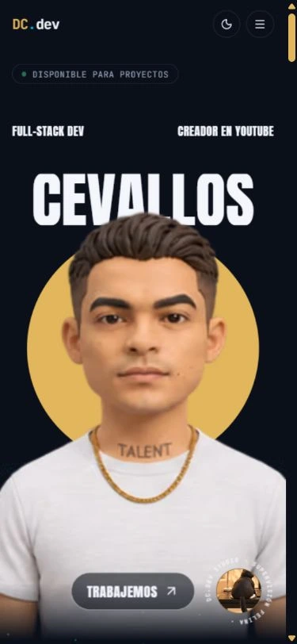
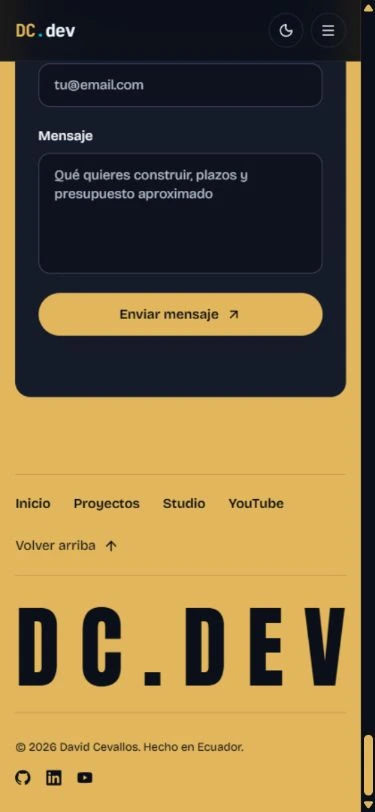
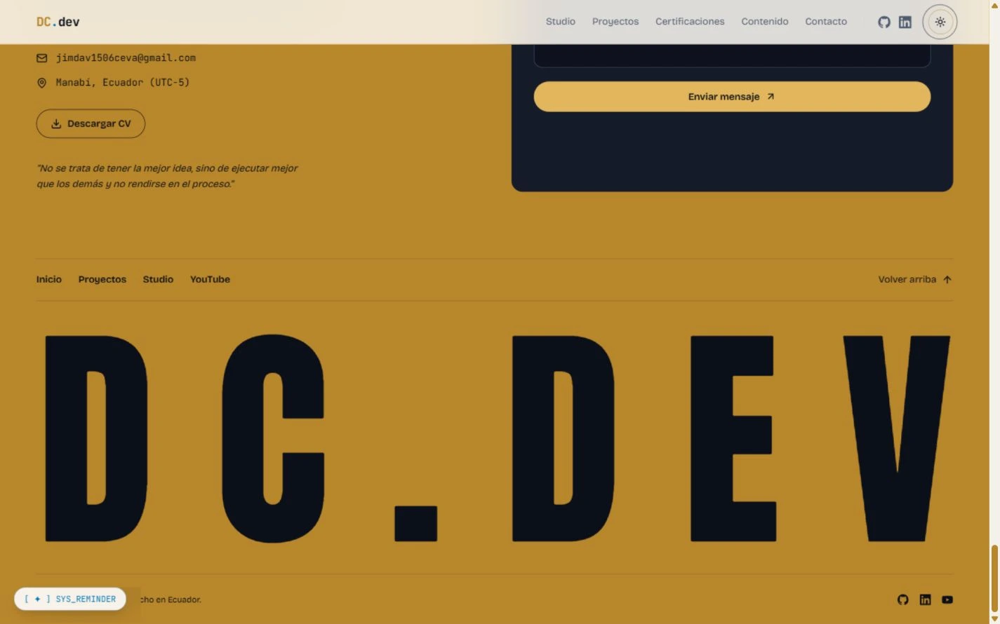

# DC.dev: cursor, footer y avatar

## Referencias y decisión

| Referencia suministrada | Aporte elegido | Uso |
| --- | --- | --- |
| propuesta 2 portafolio.mp4 (Matteo Backer) | Nombre grande, retrato, un acento y footer con rastro de proyectos | Estructura y cierre, conservando oro/obsidiana y fuentes actuales de DC.dev |
| Grabación de pantalla 2026-10-10 212345.mp4 | Avatar que mira al puntero y letras reactivas | Interacción del hero, sin trasladar su paleta verde ni su fondo de cuadrícula |
| jovenes en accion.mp4 | Narración con varias escenas del avatar | Contenido audiovisual con Play y sonido; sus cortes no funcionan como fondo permanente |

El cursor punto/anillo sigue la especificación del plan adjunto. No se copiaron cifras, premios ni testimonios de las referencias.

## Implementación

- Cursor con springs, estiramiento por velocidad y etiquetas Ver/Arrastra/Play. Delegación de eventos para filtros, contenido expandido y lightbox. Teclado, inputs, salida de ventana y reduced-motion restauran el cursor nativo. Patita blanca con almohadillas en el footer y huella dorada al pulsar; se retira la vieja patita vinculada al scroll.
- Contacto y footer dorados con formulario Web3Forms conservado, enlace de CV real, firma Anton DC.DEV y pool de ocho capturas reales. El rastro se carga únicamente con puntero fino y sin movimiento reducido. Sin video de fondo en el footer.
- Avatar de plastilina derivado de la referencia: camiseta blanca, cadena, tatuaje TALENT y rasgos conservados. Atlas de 21 poses y 2 parpadeos, con torso fijo. Canvas dibuja solo al cambiar de pose; histéresis y springs evitan parpadeo en los límites. Carga diferida después de `load` e idle, con imagen neutral prioritaria.
- Touch de al menos 4 GB (o memoria no informada): carga al primer toque, mira hacia el toque durante 1.5 s y vuelve al centro. Memoria inferior: retrato estático. Reduced-motion: sin atlas, rastro ni cursor.
- Letras CEVALLOS con capa dorada por proximidad. Rayos X requiere mantener pulsado, con equivalente de teclado; se conserva el easter egg de cinco clics.
- Videos locales de movimiento del avatar y Jóvenes en acción, con poster WebP y descarga solo después de Play. Studio y badge usan el bucle actualizado de la gata con DC.dev dentro del ThinkPad.

## Assets y límites

Atlas AVIF: 155,557 bytes. Neutral AVIF: 14,308 bytes. El generador produjo celdas de 237×316; se entregan con sus dimensiones reales en `avatar-poses.json`, sin atribuirles resolución de 4K. Las poses son imágenes generadas, no un rig 3D calibrado. El estudio de movimiento de 8 s es un montaje local de esas poses.

HeyGen rechazó crear el avatar con HTTP 403: la función exige plan de pago. No se inició un video de HeyGen ni se confirmó falta de créditos. Los prompts completos para Flow están en [FLOW-avatar-prompts.md](FLOW-avatar-prompts.md), y los prompts usados para las imágenes en [IMAGEGEN-avatar-prompts.md](IMAGEGEN-avatar-prompts.md).

El CV reúne únicamente información del perfil y de los proyectos existentes del repositorio; no añade fechas de empleo, títulos obtenidos ni métricas de impacto.

## Validación

- Lint y typecheck correctos.
- 35 pruebas unitarias.
- 28 E2E correctos y 6 omisiones deliberadas por tipo de dispositivo: mouse en móvil, touch en escritorio y easter egg de teclado en móvil.
- Build correcto. JavaScript inicial: aproximadamente 156.7 KB gzip, por debajo de 160 KB. Cursor, HeadTracker y FooterTrail permanecen en chunks independientes.
- Lighthouse de escritorio en build de producción: rendimiento 99, accesibilidad 100, buenas prácticas 100, SEO 100. FCP 0.7 s, LCP 0.9 s, TBT 50 ms, CLS 0.007. Medición local con Chrome headless y Lighthouse 13.5.0; no representa una medición de visitantes en producción. El informe se generó sin runtimeError; el launcher de Windows informó EPERM al limpiar su directorio temporal después de guardar los informes.
- Revisión de escritorio/móvil y de footer claro/oscuro. El detector señaló el pool de imágenes sin src y una clase de texto degradado sin uso: ambos corregidos.
- El RSS de YouTube devolvió 404 durante el prebuild; se conservó el JSON anterior. El formulario no se envió a una persona ni se probaron servicios externos con datos reales.

## Capturas

